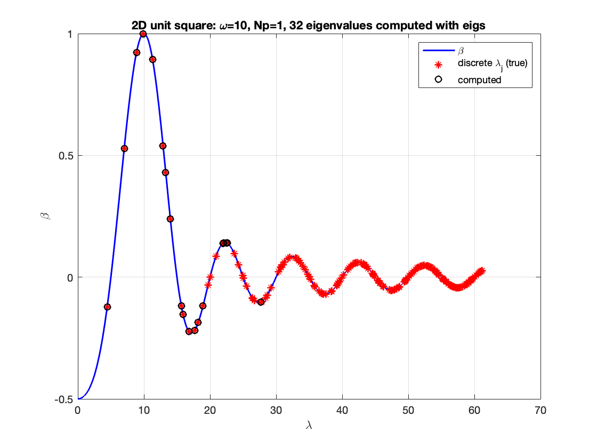

# EigenWave Algorithm for computing eigenvalues and eigenfunctions of elliptic eigenvalue problems


## Overview
This folder holds the MATLAB code for the EigenWave algorithm, which computes eigenvalues and eigenvectors of the discrete Laplacian operator,
$L_h \phi_h + \lambda_h^2 \phi_h = 0$, near a target frequency $\omega$. The discretization uses second-order finite differences.

The domains are the unit interval $[0,1]$, the unit square $[0,1]^2$, and the annulus $0.5 \le r \le 2$.


## Features
- **Algorithm implementation**
  - The algorithm first solves a related wave equation and then filters the solution of the wave equation in time.
  - The filter operator is $U = \frac{2}{T}\int_0^T \left(\cos(\omega t) - \frac{1}{4}\right) w(x,t)\,dt$; the integral is approximated with the composite trapezoidal rule.
  - This maps the eigenvalues of $L_h$ to those of $S_h = \beta(L_h)$, whose largest eigenvalues correspond to $\lambda$ near $\omega$; the eigenvectors are the same as those of $L_h$.
  - The wave equation is solved with an explicit or an implicit scheme. For the implicit scheme, the matrix $A = I - \frac{(c\Delta t)^2}{2} L_h$ is factorized once (sparse LU), and only 10 time steps per period are needed.
  - The eigensolver runs on $S_h$, treated as a black box: the matrix-vector product (one wave solve) is the only thing needed. Three solvers are available: power iteration, Arnoldi, and `eigs` (Krylov-Schur).
  - The eigenvalues of $L_h$ are recovered with a Rayleigh quotient: $\lambda_h^2 = -(\phi_h, L_h \phi_h)_h / (\phi_h, \phi_h)_h$.
  - The figure below shows the filter function $\beta(\lambda)$: the eigenvalues of $L_h$ near $\omega$ become the largest eigenvalues of $S_h$.

    

- **Verification and validation**
  - Wave solver: manufactured solutions (poly, pulse, trig, eigen). Poly is exact to round-off in 1D/2D; all other tests converge at second order. On the annulus, poly also converges at second order, since the polar stencil is not exact for polynomials in $x, y$.
  - EigenWave: results are checked against saved reference values in `reference/` (agreement to about 1e-14 for `eigs` and 1e-11 for Arnoldi); `runEigenWave.m` prints PASS/FAIL.
  - The schemes (explicit and implicit, 1D, 2D and annulus), the exact and discrete eigenvalues, and the convergence tables are documented in [docs/waveSchemes.pdf](docs/waveSchemes.pdf).


## Repository layout
```text
runEigenWave.m        driver: eigenvalues with eigs / Power / Arnoldi
runWaveSolverTest.m   driver: wave-solver convergence tests
core/                 waveSolve, filterOperator, innerProduct, normW, beta*, SolveCounter
geometry/             getDomain, setup1D, setupRectangle, setupAnnulus
manufactured/         getMS (exact solutions, forcing, BCs)
solvers/              powerMethod, arnoldi
reference/            saved results used for regression checks
```


## To run
- Tested with MATLAB R2024a.
- The two main drivers are `runWaveSolverTest.m` and `runEigenWave.m`.
- **Testing the wave solver: `runWaveSolverTest.m`**
  - Set the geometry: `'1D'` | `'2D'` | `'Annulus'`.
  - Other parameters (e.g. `cfl`, final time `T`) have default values.
  - Runs both the explicit and the implicit scheme on the tests and checks second-order convergence.
  - Example output (1D, explicit):
    ```text
    =========== 1D: Explicit scheme ===========
    ms=poly: t=6.50e-01: m=1 Nx=  40 Nt=  29 dt=2.24e-02 maxErr=2.22e-15
    ms=poly: t=6.50e-01: m=2 Nx=  80 Nt=  58 dt=1.12e-02 maxErr=3.11e-15 ratio= 0.71
    ms=poly: t=6.50e-01: m=3 Nx= 160 Nt= 116 dt=5.60e-03 maxErr=4.00e-15 ratio= 0.78
    ms=poly: t=6.50e-01: m=4 Nx= 320 Nt= 232 dt=2.80e-03 maxErr=2.00e-14 ratio= 0.20
    ms=poly: t=6.50e-01: m=5 Nx= 640 Nt= 463 dt=1.40e-03 maxErr=1.35e-14 ratio= 1.48
    ms=poly: t=6.50e-01: m=6 Nx=1280 Nt= 925 dt=7.03e-04 maxErr=4.35e-14 ratio= 0.31

    ms=pulse: t=6.50e-01: m=1 Nx=  40 Nt=  29 dt=2.24e-02 maxErr=1.31e-01
    ms=pulse: t=6.50e-01: m=2 Nx=  80 Nt=  58 dt=1.12e-02 maxErr=3.19e-02 ratio= 4.10
    ms=pulse: t=6.50e-01: m=3 Nx= 160 Nt= 116 dt=5.60e-03 maxErr=7.49e-03 ratio= 4.26
    ms=pulse: t=6.50e-01: m=4 Nx= 320 Nt= 232 dt=2.80e-03 maxErr=1.86e-03 ratio= 4.02
    ms=pulse: t=6.50e-01: m=5 Nx= 640 Nt= 463 dt=1.40e-03 maxErr=4.57e-04 ratio= 4.07
    ms=pulse: t=6.50e-01: m=6 Nx=1280 Nt= 925 dt=7.03e-04 maxErr=1.13e-04 ratio= 4.03
    ...
    ```
- **Running EigenWave: `runEigenWave.m`**
  - `geometry`: `'1D'` | `'2D'` | `'Annulus'`
  - `methodName`: `'eigs'` | `'Power'` | `'Arnoldi'`
  - `opts.scheme`: `'Explicit'` | `'Implicit'`
  - `m`: grid refinement level: 1D $N_x = 20 \cdot 2^m$; 2D $N_x = N_y = 20 \cdot 2^{m-1}$; annulus $N_r = 5 \cdot 2^m$, $N_\theta = 10 \cdot 2^m$
  - `Np`: number of periods over which the wave equation is solved ($T = N_p \, 2\pi/\omega$)
  - `numRequest`: number of eigenvalues requested (`eigs` only)
  - `opts.omega`: target frequency
  - `opts.cfl`: CFL number
  - Example output (2D, implicit, `eigs`):
    ```text
    EigenWave algorithm: Nx=Ny=40 Nt=10 T=0.63 dx=2.50e-02 dy=2.50e-02 dt=6.28e-02
    Domain: 2D, Scheme: Implicit, Method: eigs
    numComputed = 16, totalTime =  0.21(s)
    numWaveSolves = 81 (5.1 per eigenvalue)
    timeFactor = 1.48e-02(s) (factorize the implicit matrix, size 1681)
        disLambda           comLambda          err
      15.9201139449       15.9201139449      1.78e-15
      15.9201139449       15.9201139449      3.55e-15
      15.6536066957       15.6536066957      0.00e+00
      15.6536066957       15.6536066957      1.78e-15
      14.0005877716       14.0005877716      1.78e-15
      14.0005877716       14.0005877716      3.55e-15
      13.2978385257       13.2978385257      1.78e-15
      12.9028554944       12.9028554944      7.11e-15
      12.9028554944       12.9028554944      1.78e-15
      11.3054661480       11.3054661480      0.00e+00
      11.3054661480       11.3054661480      3.55e-15
       9.9136666669        9.9136666669      3.55e-15
       9.9136666669        9.9136666669      1.78e-15
       8.8766333816        8.8766333816      0.00e+00
       7.0186780913        7.0186780913      2.66e-15
       7.0186780913        7.0186780913      1.78e-15

    Reference .../reference/2D_Implicit_eigs.mat:
      max|comLambda-ref| = 5.33e-15, max|disLambda-ref| = 0.00e+00  PASS
    ```


## Notes
- **Annulus time step:** the CFL condition on the annulus uses the smallest grid spacing in $\theta$, $r_{\min}\Delta\theta$. (An earlier version used $\Delta\theta$, which made the explicit scheme unstable at `cfl = 0.9`; `reference/Annulus_Explicit_eigs.mat` was regenerated with the corrected time step.)
- **Annulus convergence:** power iteration and Arnoldi converge slowly on the annulus because many eigenvalues of $S_h$ cluster near 1; `eigs` (with restarts) is recommended there.


## Reference
- D. Appelö, J. W. Banks, W. D. Henshaw, *EigenWave: An optimal $\mathcal{O}(N)$ method for computing eigenvalues and eigenvectors by time-filtering the wave equation*, Journal of Computational Physics, Volume 555, 2026, 114758, ISSN 0021-9991. [doi:10.1016/j.jcp.2026.114758](https://doi.org/10.1016/j.jcp.2026.114758)


